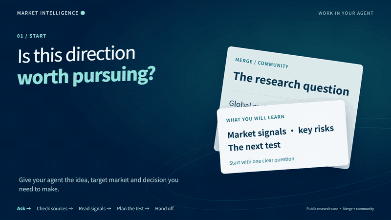

# Game Market Intelligence Director

[中文](README.md)

<picture>
  <source media="(prefers-reduced-motion: reduce)" srcset="assets/readme/hero-en.png">
  
</picture>

[▶ Watch the 24-second MP4](assets/readme/hero-en.mp4) · [中文 MP4](assets/readme/hero-zh.mp4)

Turn a Merge/community game thesis into global market evidence, comparable definitions, and the next validation. This role gives game directors, producers, and agents one research baseline. It does not present a source catalog as connected APIs or approve a project on a lead's behalf.

[30-second start](docs/HUMAN-GUIDE.en.md) · [Agent guide](docs/AGENT-GUIDE.en.md) · [Read the canonical skill](SKILL.md) · [Source catalog](references/source-catalog.md) · [Real case](case-studies/merge-community-public-signals/README.en.md) · [Darwin review](evals/darwin-review.md)

  

## Completed real case

The [Merge + community public-signals brief](case-studies/merge-community-public-signals/README.en.md) uses Google Play, a first-party Metacore disclosure, and AppMagic-based industry estimates to test whether demand exists and whether the entry window is wide enough. Facts, estimates, and unknowns stay separate, and the recommendation remains `proposed`.

[](case-studies/merge-community-public-signals/dashboard-en.png)

## Start now

```text
git clone https://github.com/NewenergyEric/game-market-intelligence.git
cd game-market-intelligence
python scripts/intelligence.py sources --topic market --region china --platform mobile
python scripts/intelligence.py validate case-studies/merge-community-public-signals/report.json
python scripts/intelligence.py report case-studies/merge-community-public-signals/report.json --out outputs/merge-report
```

Ask an agent with GitHub or local-file access to read `SKILL.md` first, then provide your project material. The core tool uses only the Python 3.10+ standard library.

## Outputs

| Input question | Output |
|---|---|
| Is this category and market worth investigating? | Decision summary, market scope, and key risks |
| Which products are comparable? | Source lineage and aligned platform, region, and period definitions |
| Can title-level revenue support the decision? | Separate facts, estimates, inferences, and unknowns |
| What should we obtain next? | Validation plan, data requests, and role handoff questions |

The catalog contains 77 domestic and international entry points across title estimates, PC/console, industry reports, first-party disclosures, user acquisition, player observation, owned channels, and regulation. **A catalog entry does not mean the repository owns an account, has API access, or automates collection.**

## Role handoffs

| Role | Delivery |
|---|---|
| Game Market Intelligence Director | Evidence, business judgment, risks, and validation proposals |
| [Game Reverse Analyst](https://github.com/NewenergyEric/game-reverse-analyst) | Mechanics, architecture, rules, asset structure, and unknowns |
| [Game Production Manager](https://github.com/NewenergyEric/game-production-manager) | SOW, work packages, tasks, milestones, and acceptance |
| [Art Director](https://github.com/NewenergyEric/art-director-skill) | Visual standards, asset families, exemplars, and team rule packs |

Market intelligence provides the basis, reverse analysis provides structure, production management turns confirmed direction into an execution contract, and the Art Director owns professional visual standards.

## Evidence boundaries

- Treat title-level numbers from Sensor Tower, AppMagic, Qimai, Diandian, and similar providers as third-party estimates.
- Use financial and publisher disclosures in their original scope; do not allocate them to a title, region, or channel without evidence.
- SteamDB activity, ratings, ad counts, and reviews are not direct evidence of sales, profit, or ROAS.
- Preserve unavailable values as `null` with a reason. Keep recommendations `proposed` until the accountable lead confirms them.

Run `python -m unittest discover -s tests -v` to validate the tool. Tests and reviews live in [`evals/`](evals/); project comparisons are in the [GitHub reference scan](references/github-reference-scan.md). Private exports, credentials, and raw commercial material stay outside the repository.

MIT licensed.
