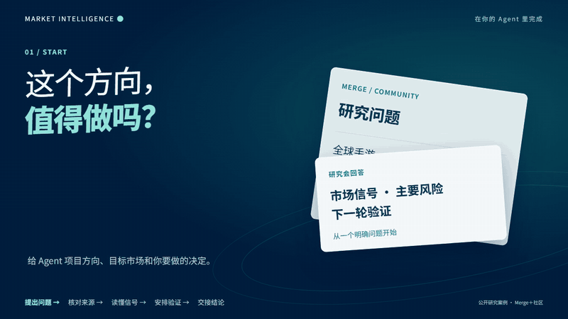
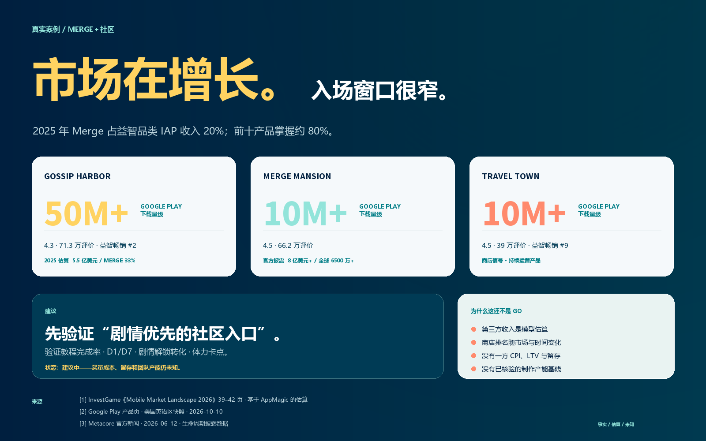

# 游戏市场研究总监

[English](README.en.md)

<picture>
  <source media="(prefers-reduced-motion: reduce)" srcset="assets/readme/hero-zh.png">
  
</picture>

把 Merge／社区游戏的立项问题变成国内外市场证据、可比较的指标口径和下一步验证。这个岗位让主策、制作人和 Agent 读同一份研究底稿；它不会把来源目录伪装成已接通 API，也不会替负责人批准立项。

[30 秒开始](docs/HUMAN-GUIDE.md) · [Agent 调用说明](docs/AGENT-GUIDE.md) · [读取 Skill](SKILL.md) · [来源目录](references/source-catalog.md) · [真实案例](case-studies/merge-community-public-signals/README.md) · [Darwin 审查](evals/darwin-review.md)

  

## 已完成的真实案例

[Merge＋社区公开信号研究](case-studies/merge-community-public-signals/README.md)用 Google Play、Metacore 一方披露和 AppMagic 驱动的行业估算，回答“市场是否存在、入口是否足够宽”这两个问题。它把事实、估算和未知分开，结论保持 `proposed`。

[](case-studies/merge-community-public-signals/dashboard-zh.png)

## 立即使用

```text
git clone https://github.com/NewenergyEric/game-market-intelligence.git
cd game-market-intelligence
python scripts/intelligence.py sources --topic market --region china --platform mobile
python scripts/intelligence.py validate case-studies/merge-community-public-signals/report.json
python scripts/intelligence.py report case-studies/merge-community-public-signals/report.json --out outputs/merge-report
```

把仓库交给能读取 GitHub 或本地文件的 Agent，要求它先读 `SKILL.md`，再提供你的项目资料。Python 3.10+，核心工具只使用标准库。

## 输出

| 输入问题 | 输出 |
|---|---|
| 这个品类和地区值不值得研究 | 决定摘要、市场范围与关键风险 |
| 哪些竞品可比 | 来源血缘、平台／地区／时间口径和比较表 |
| 单款流水能否支持判断 | 分开的事实、估算、推断与未知 |
| 下一步该补什么 | 验证清单、数据请求和岗位交接问题 |

目录当前收录 77 个国内外研究入口，覆盖单款估算、PC／主机、行业报告、一方披露、买量、玩家观察、自有渠道和监管。**收录不代表已经购买账号、取得 API 权限或接通自动采集。**

## 岗位协作

| 岗位 | 交付 |
|---|---|
| 游戏市场研究总监 | 证据、经营判断、风险和验证建议 |
| [游戏拆解与逆向分析师](https://github.com/NewenergyEric/game-reverse-analyst) | 玩法、架构、规则、资产结构和未知项 |
| [游戏制作项目经理](https://github.com/NewenergyEric/game-production-manager) | SOW、工作包、任务、里程碑和验收 |
| [美术总监](https://github.com/NewenergyEric/art-director-skill) | 视觉规范、资产家族、样板和团队规则包 |

市场研究给依据，拆解给结构，项目经理把已确认方向变成执行契约，Art Director 负责专业美术标准。实际产物由对应的人或 Agent 执行并返回证据。

## 证据边界

- Sensor Tower、AppMagic、七麦、点点等单款数字按第三方估算处理。
- 财报和发行商披露按原口径使用，不能自行摊到单款、地区或渠道。
- SteamDB 活跃曲线、评分、广告素材量和评论不能直接当销量、利润或 ROAS。
- 未知值保留 `null` 和原因；市场建议保持 `proposed`，直到负责人明确确认。

运行 `python -m unittest discover -s tests -v` 验证工具。测试、Darwin prompt 和反馈见 [`evals/`](evals/)；同类项目取舍见 [GitHub 参考扫描](references/github-reference-scan.md)。私人导出、账号配置和原始商业资料不随仓库发布。

本仓库使用 MIT。
