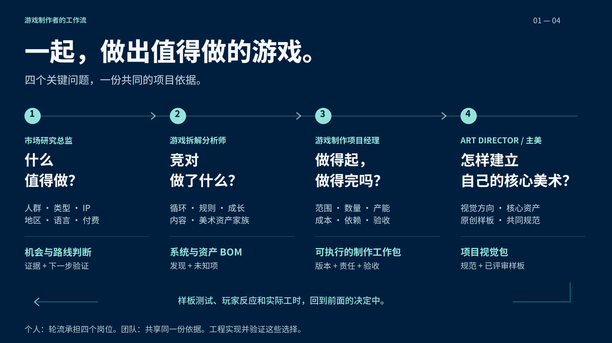

[English](README.en.md)

[**Game Dev Skills**](https://github.com/NewenergyEric/NewenergyEric/blob/main/GAME-DEV-SKILLS.md) · [市场研究](https://github.com/NewenergyEric/game-market-intelligence) · [游戏拆解](https://github.com/NewenergyEric/game-reverse-analyst) · [制作管理](https://github.com/NewenergyEric/game-production-manager) · [美术总监](https://github.com/NewenergyEric/art-director-skill)

# 游戏市场研究总监

### 看清市场，决定下一步。

决定一个游戏怎么进入市场，要把玩家与玩法、IP、地区渠道、语言文化、付费方式、竞争和团队产能放在一起看。这个 Skill 引导 Agent 建比较底稿，保留证据，再把关键缺口变成验证任务。

<picture>
  <source media="(prefers-reduced-motion: reduce)" srcset="assets/readme/hero-zh.png?v=depth-v4">
  
</picture>

[下载完整介绍 · 24 秒 MP4](assets/readme/hero-zh.mp4?raw=true) · [GIF](assets/readme/hero-zh.gif) · [文字版](assets/readme/transcript-zh.md)

## 为什么做这个

**立项时缺的，常常是把几个方向放在一起判断的依据。**

榜单、商店页、行业报告各说一部分。真正要回答的是：这个类型适合哪些玩家，进入哪个地区，付费方式与内容产能能否匹配。研究应留下来源、差异和下一步要验证的事，让团队能继续判断。

它是 Game Dev Skills 的市场岗位。先缩小值得研究的方向，再把问题交给拆解分析，把证据和缺口带进项目评估。一个人可以轮流做四岗；团队可以按职责接手。

## 装好，然后直接说

```sh
npx skills add https://github.com/NewenergyEric/game-market-intelligence
```

在支持 Agent Skills 的工具中安装，例如 Codex、Claude Code、Cursor；将资料放进 Agent 能读取的位置，再描述问题。

### 跨类型选择

> 我们擅长社区叙事。比较 Merge 手游、IP 社交和买断模拟：各自适合谁、靠什么收入、对内容产能要求如何？

得到六维对照、可核对来源、差异与缺口；不会把跨平台收入直接排成名次。

### 进入新地区

> 同一玩法进日本、北美、巴西，语言、支付、渠道、文化适配和竞争分别要验证什么？

按地区建立研究计划与证据表。付费数据库或本地指标不可用时，明确标为未知。

### 从观察到下一轮实验

> 支持 12 种语言能说明什么？我们还缺哪些证据才适合立项？

区分语言能力与市场表现，把 CPI/LTV、IP 条款、内容与本地化产能交给对应负责人验证。

## 看一个具体案例

**真实公开研究：Gossip Harbor、MONOPOLY GO!、Stardew Valley。** 三款产品 × 六个比较维度，18 个带证据 ID 的单元；覆盖类型、IP、地区、语言、付费与产能。保留原 Merge 行业案例，新增跨类型比较。

[完整分析与可下载底稿](case-studies/cross-market-entry/README.md)

[](case-studies/cross-market-entry/dashboard-zh.png)

[继续看 Merge 行业的收入、增长与集中度案例](case-studies/merge-community-public-signals/README.md)

## 最后交给团队什么

- 跨类型比较底稿 — `comparison.csv`
- 可分享研究报告 — `report.html`
- 结论、来源与缺口 — `report.json`

<details>
<summary>能力边界、说明书与验证</summary>

79 个国内外数据源入口不等于 79 个已连接 API。单款估算、财报分部、商店观察分别保留口径；语言不等于地区收入，授权 IP 不等于获得我方使用权。公开比较不包含投放实验或未取得的付费数据。

核心工具使用 Python 3.10+ 标准库；动画源码是可选的 Remotion 工程。

[人类说明书](docs/HUMAN-GUIDE.md) · [Agent guide](docs/AGENT-GUIDE.md) · [SKILL.md](SKILL.md) · [Tests and review](evals/) · [Motion source](motion/README.md)

```sh
python -m unittest discover -s tests -v
python scripts/check_presentation.py
```

</details>

[MIT License](LICENSE) · Made by Eric and Agents.

## 告诉我，你在哪一步卡住

用过一次后，欢迎留下：你想完成什么、给了哪些可公开资料、拿到了什么，以及还缺哪一步。

[分享使用反馈或案例](https://github.com/NewenergyEric/game-market-intelligence/issues/new?template=use-case.yml)

## 四个岗位，共同做出值得做的游戏

个人制作者可以轮流承担四个岗位；团队通过同一份资料交接：什么值得做、竞对做了什么、资源和体量如何评估，以及如何创作自己的核心美术。

[岗位如何交接证据、范围与美术资产](docs/WORKFLOW.md) · [四岗位总览](https://github.com/NewenergyEric/NewenergyEric/blob/main/GAME-DEV-SKILLS.md)

| 眼前的问题 | 从这个岗位开始 | 带到下一步的资料 |
|---|---|---|
| 什么值得做？ | [市场研究](https://github.com/NewenergyEric/game-market-intelligence) | 机会比较、来源与验证缺口 |
| 竞对做了什么？ | [游戏拆解](https://github.com/NewenergyEric/game-reverse-analyst) | 规则、实现依据与资产 BOM |
| 做得起，也做得完吗？ | [制作管理](https://github.com/NewenergyEric/game-production-manager) | SOW、工作包、依赖与验收 |
| 核心美术如何建立？ | [美术总监](https://github.com/NewenergyEric/art-director-skill) | 共享规范、代表样板与项目包 |

**个人创作者：** 从当前卡住的问题开始，按需要切换岗位。**团队：** 用实际报告、BOM、工作包和美术规范交接；每一步保留来源、版本与未定项。

这是协作方法，当前没有自动串行执行四个 Agent 的编排器。


