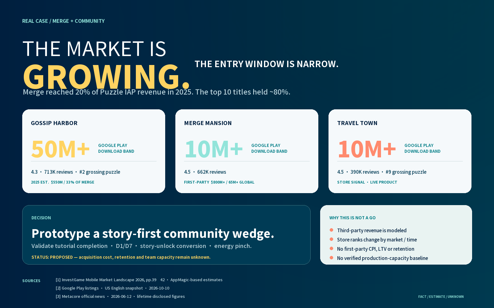

# Merge + Community Public-Signals Brief

[中文](README.zh.md) · [Machine-readable baseline](report.json) · [Chinese dashboard](dashboard-zh.png)

[](dashboard-en.png)

**Question:** If we continue in the Merge/community direction, do public market signals support a project greenlight or only another validation round?

**Finding:** Merge grew from 14% of Puzzle IAP revenue in 2024 to 20% in 2025, while the top ten products held roughly 80% of segment revenue. The evidence supports a real market with concentrated leaders. It does not support a GO. The proposed next step is a narrow, story-first community wedge.

## Evidence table

| Signal | Type | Observed value | Interpretation |
|---|---|---:|---|
| Merge share of Puzzle IAP revenue | Third-party estimate | 20% (2025) | Worldwide App Store + Google Play IAP; excludes webshops and other revenue |
| Top-ten Merge revenue concentration | Third-party estimate | ~80% (2025) | The market has scale, but entry is concentrated among strong products |
| Gossip Harbor annual revenue | Third-party estimate | $550M (2025) | About 33% of Merge segment revenue; not a financial disclosure |
| Gossip Harbor on Google Play | Store observation | 50M+ downloads; 4.3 rating | A current store band and review snapshot, not all-channel installs or retention |
| Merge Mansion lifetime performance | First-party publisher disclosure | $800M+; 65M+ global downloads | Lifetime scope with no region, channel, or annual split |
| Our CPI, LTV, D1/D7, and capacity | Unknown | — | No first-party baseline; competitor estimates cannot substitute for it |

## Next validation

1. Build a narrow prototype where story and visible community relationships lead.
2. Measure tutorial completion, D1/D7, story-unlock conversion, and the energy pinch.
3. Obtain target-market CPI, acceptable LTV, and a verified team-capacity baseline.
4. Change `proposed` to `confirmed` only after the accountable lead's predeclared gates are met.

## Reproduce

```text
python scripts/intelligence.py validate case-studies/merge-community-public-signals/report.json
python scripts/intelligence.py report case-studies/merge-community-public-signals/report.json --out outputs/merge-community-public-signals
```

## Sources and scope

- [InvestGame, *Mobile Market Landscape 2026*](https://investgame.net/wp-content/uploads/2026/02/2026-02-06-upload_Reports_EN_MobileMarkeLandscape2026.pdf), pp. 39–42; the report identifies AppMagic as its estimate source.
- [Gossip Harbor on Google Play](https://play.google.com/store/apps/details?hl=en-US&id=com.mergegames.gossipharbor), [Merge Mansion on Google Play](https://play.google.com/store/apps/details?hl=en-US&id=com.everywear.game5), and [Travel Town on Google Play](https://play.google.com/store/apps/details?hl=en-US&id=io.randomco.travel), checked 2026-10-10. Store signals change over time.
- [Metacore official news](https://metacoregames.com/news/metacore-appoints-jose-saarniniemi-as-general-manager-of-merge-mansion), 2026-06-12; the $800M+ and 65M+ figures are publisher disclosures.

This case uses public, shareable material only. Estimates, observations, and unknowns are labeled. It does not claim a paid API connection or publish raw commercial-project data.
